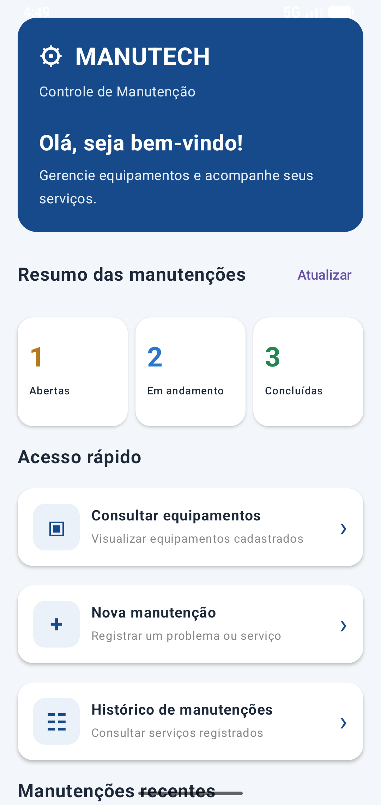
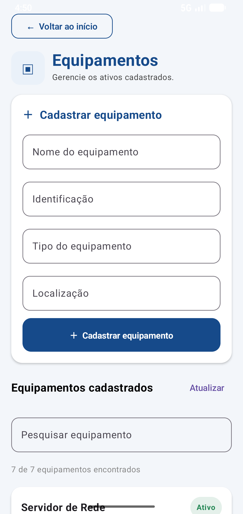
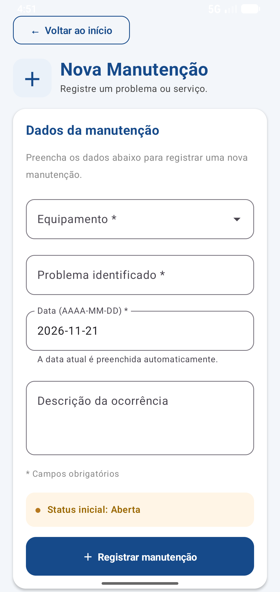
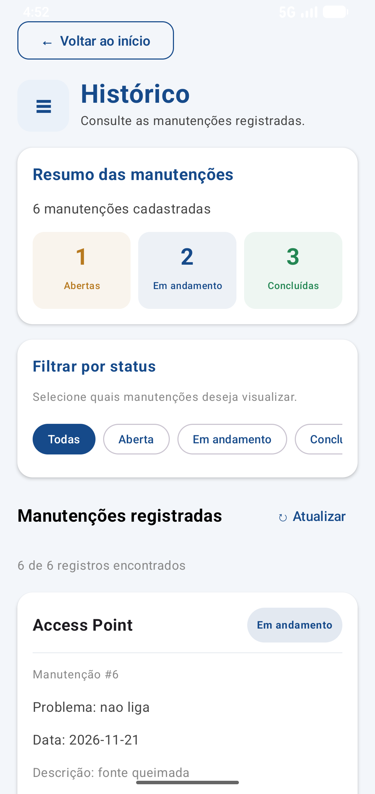
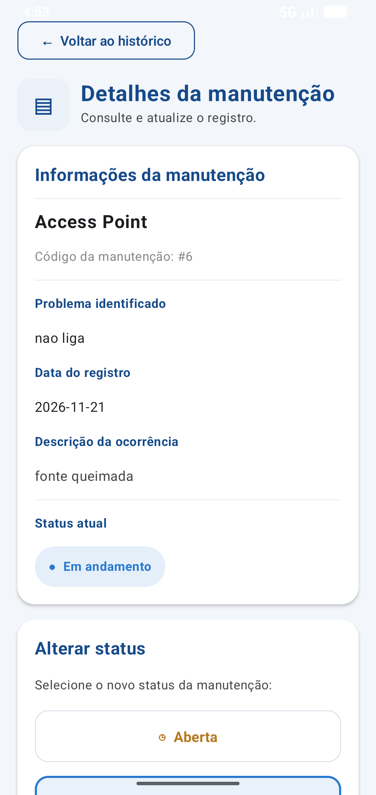

# 🛠️ Manutech Mobile

Aplicativo Android para gerenciamento de equipamentos e controle de manutenções, desenvolvido como projeto acadêmico do curso Técnico em Informática do Instituto Federal do Espírito Santo (IFES).

## 📖 Sobre o projeto

O Manutech Mobile foi desenvolvido com o objetivo de facilitar o gerenciamento de ativos e o acompanhamento de manutenções de equipamentos.

O aplicativo permite cadastrar equipamentos, registrar ocorrências, consultar o histórico de manutenções e acompanhar a evolução dos serviços realizados.

Os dados são armazenados em um banco de dados MySQL, por meio da integração com uma API desenvolvida em PHP.

## 🎯 Objetivos

- Facilitar o controle de equipamentos.
- Organizar os registros de manutenção.
- Acompanhar o andamento das atividades.
- Centralizar as informações dos equipamentos.
- Melhorar a consulta ao histórico de ocorrências.
- Garantir a persistência dos dados.

## 📱 Funcionalidades

### Tela inicial

- Dashboard com indicadores de manutenção.
- Quantidade de manutenções abertas.
- Quantidade de manutenções em andamento.
- Quantidade de manutenções concluídas.
- Exibição das manutenções recentes.
- Navegação entre as principais telas.

### Gerenciamento de equipamentos

- Cadastro de equipamentos.
- Listagem dos equipamentos cadastrados.
- Registro de nome, identificação, tipo e localização.
- Validação dos campos obrigatórios.
- Bloqueio de identificações duplicadas.
- Pesquisa por nome, identificação, tipo e localização.
- Exclusão de equipamentos com confirmação.
- Proteção contra exclusão de equipamentos com manutenções vinculadas.

### Nova manutenção

- Seleção de equipamentos cadastrados.
- Registro do problema identificado.
- Descrição da ocorrência.
- Preenchimento automático da data.
- Validação dos campos.
- Armazenamento dos registros no banco de dados.

### Histórico de manutenções

- Listagem das manutenções registradas.
- Resumo quantitativo das manutenções.
- Filtro por status.
- Atualização da lista.
- Acesso aos detalhes de cada manutenção.

### Detalhes da manutenção

- Visualização das informações completas.
- Identificação do equipamento.
- Consulta ao problema e à descrição.
- Visualização da data do registro.
- Alteração do status da manutenção.

### Status disponíveis

- 🟠 Aberta
- 🔵 Em andamento
- 🟢 Concluída

## 💻 Tecnologias utilizadas

| Tecnologia | Finalidade |
|---|---|
| Kotlin | Linguagem de programação |
| Jetpack Compose | Desenvolvimento das interfaces |
| Material Design 3 | Componentes e identidade visual |
| Navigation Compose | Navegação entre telas |
| Retrofit | Comunicação com a API |
| OkHttp | Requisições HTTP |
| Gson | Conversão de dados JSON |
| Kotlin Coroutines | Operações assíncronas |
| PHP | Desenvolvimento da API |
| MySQL | Banco de dados |
| UsbWebServer | Ambiente de servidor local |
| Android Studio | Ambiente de desenvolvimento |
| Git e GitHub | Controle de versão |

## 🏗️ Arquitetura do sistema

O aplicativo utiliza uma arquitetura cliente-servidor.

    Aplicativo Android
    Kotlin + Jetpack Compose
             ↕
       Retrofit / HTTP
             ↕
           API PHP
             ↕
       Banco de dados MySQL

O aplicativo realiza requisições HTTP à API PHP, responsável por consultar, cadastrar, atualizar e excluir informações no banco de dados MySQL.

Os dados são enviados e recebidos no formato JSON.

## 📂 Estrutura do projeto Android

    com.example.manutech/
    │
    ├── api/
    │   ├── ApiService.kt
    │   ├── RetrofitClient.kt
    │   └── CadastroResponse.kt
    │
    ├── model/
    │   ├── Equipamento.kt
    │   ├── EquipamentoRequest.kt
    │   ├── Manutencao.kt
    │   ├── ManutencaoRequest.kt
    │   ├── AtualizarStatusRequest.kt
    │   └── ExcluirEquipamentoRequest.kt
    │
    ├── screens/
    │   ├── EquipamentosScreen.kt
    │   ├── NovaManutencaoScreen.kt
    │   ├── HistoricoScreen.kt
    │   └── DetalhesManutencaoScreen.kt
    │
    ├── AppNavigation.kt
    └── MainActivity.kt

## 🌐 API PHP

A API é responsável pela comunicação entre o aplicativo Android e o banco de dados.

| Arquivo | Método | Funcionalidade |
|---|---|---|
| conexao.php | - | Conexão com o MySQL |
| listar_equipamentos.php | GET | Listar equipamentos |
| cadastrar_equipamento.php | POST | Cadastrar equipamentos |
| excluir_equipamento.php | POST | Excluir equipamentos |
| listar_manutencoes.php | GET | Listar manutenções |
| cadastrar_manutencao.php | POST | Registrar manutenção |
| atualizar_status_manutencao.php | POST | Atualizar status |

## 🗄️ Banco de dados

Nome do banco de dados:

    manutech_mobile

### Tabela equipamentos

| Campo | Tipo |
|---|---|
| id | INT - Chave primária |
| nome | VARCHAR(100) |
| identificacao | VARCHAR(50) - Único |
| tipo | VARCHAR(100) |
| localizacao | VARCHAR(150) |
| status | VARCHAR(30) |

### Tabela manutencoes

| Campo | Tipo |
|---|---|
| id | INT - Chave primária |
| id_equipamento | INT - Chave estrangeira |
| problema | VARCHAR(200) |
| descricao | TEXT |
| data | DATE |
| status | VARCHAR(30) |

### Relacionamento

    EQUIPAMENTOS (1) ───────── (N) MANUTENCOES

Um equipamento pode possuir diversas manutenções, enquanto cada manutenção está vinculada a um equipamento específico.

O relacionamento garante a integridade referencial dos registros.

## ⚙️ Configuração e execução

### Pré-requisitos

- Android Studio.
- Android SDK.
- Emulador Android ou dispositivo físico.
- UsbWebServer.
- Servidor Apache.
- MySQL.
- PHP.
- Git.

### Configuração do servidor

1. Iniciar o UsbWebServer.
2. Ativar os serviços Apache e MySQL.
3. Configurar o Apache na porta 8080.
4. Configurar o MySQL na porta 3307.
5. Criar ou importar o banco manutech_mobile.
6. Colocar a pasta manutech_api dentro da pasta root do UsbWebServer.
7. Configurar os dados de conexão no arquivo conexao.php.

Endereço local da API:

    http://127.0.0.1:8080/manutech_api/

### Configuração do aplicativo

1. Clonar o repositório do projeto.
2. Abrir o projeto no Android Studio.
3. Aguardar a sincronização do Gradle.
4. Iniciar o emulador Android.
5. Verificar a URL da API no RetrofitClient.kt.
6. Configurar o redirecionamento da porta 8080.
7. Executar o aplicativo.

### Redirecionamento de porta

No terminal PowerShell do Android Studio, executar:

    & "$env:LOCALAPPDATA\Android\Sdk\platform-tools\adb.exe" reverse tcp:8080 tcp:8080

Esse comando permite que o emulador acesse o servidor local utilizando o endereço configurado no aplicativo.

Caso o emulador seja reiniciado, poderá ser necessário executar o comando novamente.

## 🎨 Interface do aplicativo

O Manutech Mobile possui uma interface desenvolvida com Jetpack Compose e Material Design 3, utilizando:

- Identidade visual padronizada.
- Cartões com cantos arredondados.
- Indicadores coloridos de status.
- Botões personalizados.
- Formulários organizados.
- Mensagens de confirmação e erro.
- Indicadores de carregamento.
- Campos de pesquisa e filtros.

## 📸 Capturas de tela

A seguir, são apresentadas as principais telas do Manutech Mobile.

| Tela inicial | Equipamentos | Nova manutenção |
|:---:|:---:|:---:|
|  |  |  |

| Histórico de manutenções | Detalhes da manutenção |
|:---:|:---:|
|  |  |

As interfaces foram desenvolvidas utilizando Jetpack Compose e Material Design 3, proporcionando uma navegação intuitiva e uma identidade visual padronizada.

## 🧪 Testes realizados

- [x] Navegação entre as telas.
- [x] Cadastro de equipamentos.
- [x] Validação dos campos obrigatórios.
- [x] Verificação de identificação duplicada.
- [x] Pesquisa de equipamentos.
- [x] Exclusão de equipamentos.
- [x] Proteção de equipamentos vinculados.
- [x] Cadastro de manutenções.
- [x] Listagem das manutenções.
- [x] Filtro por status.
- [x] Visualização dos detalhes.
- [x] Atualização do status.
- [x] Comunicação com a API PHP.
- [x] Persistência dos dados no MySQL.
- [x] Tratamento de falhas de comunicação.

## 🚀 Melhorias futuras

- Autenticação de usuários.
- Controle de permissões.
- Cadastro de responsáveis pelas manutenções.
- Classificação por prioridade.
- Geração de relatórios.
- Notificações de manutenção.
- Hospedagem da API em servidor remoto.
- Inclusão de imagens nas ocorrências.
- Agendamento de manutenções preventivas.

## 📊 Situação do projeto

O aplicativo encontra-se funcional, com as principais funcionalidades implementadas, integração com a API PHP, persistência de dados no MySQL e testes realizados em ambiente local.

## 👨‍💻 Desenvolvedores

- Carlos Magno de Assis
- Nicolas Cruz

## 🎓 Informações acadêmicas

- **Instituição:** Instituto Federal do Espírito Santo (IFES)
- **Curso:** Técnico em Informática
- **Disciplina:** Desenvolvimento Mobile
- **Semestre:** 2026/2
- **Projeto:** Manutech Mobile

## 📄 Finalidade

Projeto desenvolvido para fins acadêmicos, aplicando os conhecimentos adquiridos durante o curso Técnico em Informática, com foco em desenvolvimento mobile, integração de sistemas e banco de dados.

---

Desenvolvido por Carlos Magno de Assis e Nicolas Cruz — IFES, 2026.
